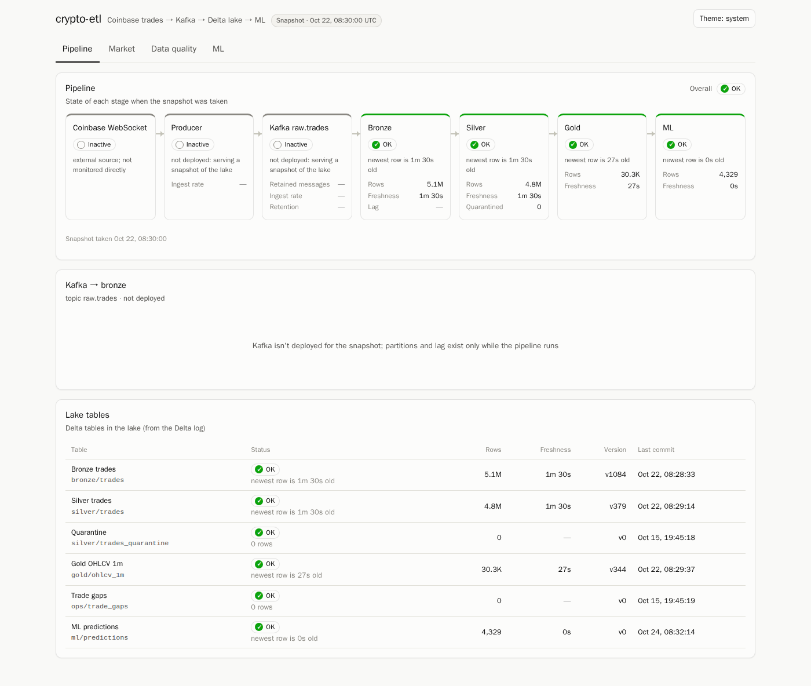
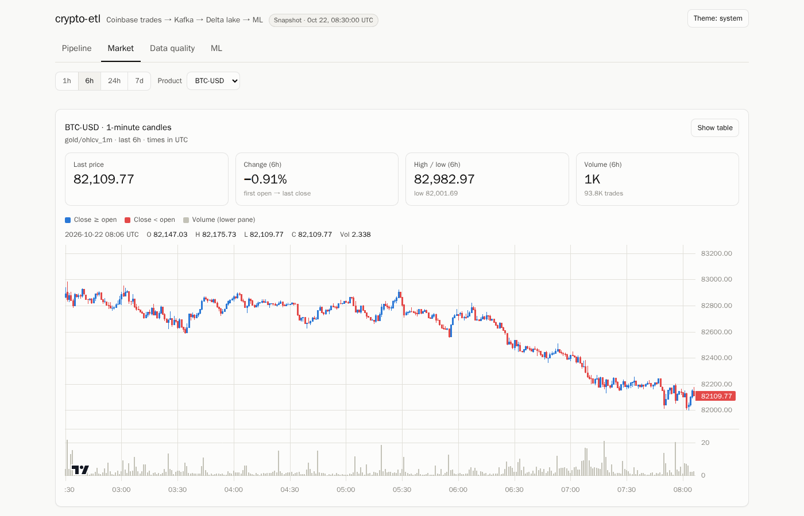
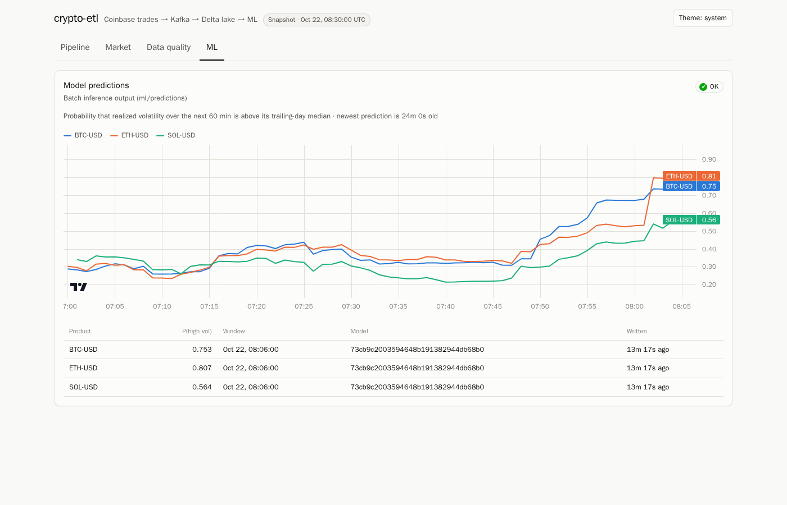
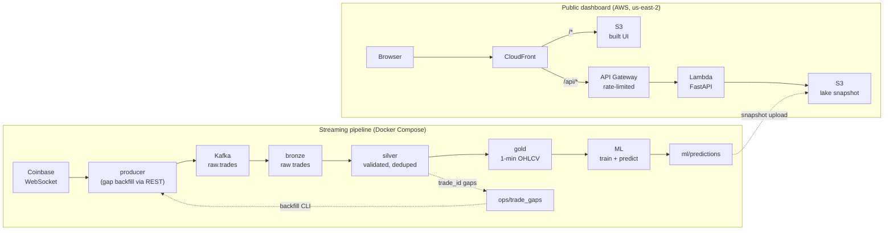

# crypto-etl

Real-time streaming ETL for crypto trades: Coinbase → Kafka → Spark Structured Streaming → a bronze/silver/gold
Delta Lake on S3, feeding a volatility-forecasting model and a full-stack dashboard.

[](https://github.com/PhaseYon/crypto-etl/actions/workflows/ci.yml)

**[Live demo → d34gy7tdgjya4a.cloudfront.net](https://d34gy7tdgjya4a.cloudfront.net)**

The demo serves a frozen snapshot of one week of trades (Oct 15–22, 2026), taken on Oct 22 at 08:30 UTC. The
streaming pipeline runs locally; only the dashboard is deployed, and it says so ("Snapshot" in the header, Kafka
marked "not deployed").



| Market | ML |
|---|---|
|  |  |

## By the numbers

All figures are measured on this project's data and deployment.

| | |
|---|---|
| **Trades processed** | 4.8M+ Coinbase trades (BTC, ETH, SOL), ~$4.6B notional volume, in a one-week lake |
| **Throughput** | up to ~5,000 trades/s into bronze (the configured Kafka read limit) while replaying the week |
| **Live latency** | exchange → bronze p50 5 s, p95 9 s |
| **Completeness** | 100% `trade_id` completeness and 0 duplicates in silver; gold candles reconcile exactly with silver |
| **Recovery** | REST backfill recovered 164K+ missed trades after a 6-hour outage |
| **Dashboard API** | server and client-side caching cut p50 latency from 91 ms to 2 ms and backend reads by 92% |
| **Deployment** | load-tested at 1,100+ req/s with 0% errors through CloudFront |
| **Model** | volatility regime 60 min ahead: 67% accuracy and 0.74 ROC-AUC in walk-forward validation vs a 50% baseline; 0.67 AUC on the held-out test split |

## Architecture



Bronze, silver and gold are Delta tables written by Spark Structured Streaming jobs to S3-compatible storage
(RustFS locally). Interfaces between components (Kafka message format, table schemas, configuration) are defined
in [docs/CONTRACTS.md](docs/CONTRACTS.md).

| Component | What it does | Docs |
|---|---|---|
| `producer/` | Coinbase WebSocket → Kafka with an idempotent producer. Reconnects with backoff, detects `trade_id` gaps and backfills them from the REST API (also across restarts), shuts down gracefully, and includes a backfill CLI | [producer/README.md](producer/README.md) |
| `lake/` | Spark jobs: bronze (raw), silver (parsed, validated, deduplicated with Delta MERGE, bad records quarantined), gold (1-minute OHLCV, corrected by late data), trade-gap detection, compaction and vacuum | [lake/README.md](lake/README.md) |
| `ml/` | Leakage-safe features and labels, time-based splits with an embargo, walk-forward validation, baselines vs candidates, MLflow tracking, batch inference | [ml/README.md](ml/README.md) |
| `api/`, `ui/` | Read-only FastAPI backend and React + TypeScript dashboard: pipeline health, market candles, data quality, ML predictions | [ui/README.md](ui/README.md) |
| `infra/` | Terraform for the AWS deployment, deploy scripts, k6 load test, GitHub Actions deploy via OIDC | [infra/README.md](infra/README.md) |

## Tech stack

| Area | Tools |
|---|---|
| Streaming and storage | Kafka 4.1 (KRaft), Spark 4.1 Structured Streaming, Delta Lake 4.4, delta-rs, RustFS (S3-compatible) / AWS S3 |
| ML | scikit-learn, pandas, MLflow |
| Backend and frontend | Python 3.14, FastAPI, React 19, TypeScript, Vite, TanStack Query, lightweight-charts |
| Cloud | AWS Lambda (container image + Lambda Web Adapter), API Gateway, CloudFront, S3, ECR, CloudWatch, Terraform |
| Quality | pytest, Vitest, Playwright, k6, ruff, ESLint, Prettier, GitHub Actions (CI + OIDC deploy) |

## Quick start

```bash
cp .env.example .env        # then replace the <PLACEHOLDER> credentials
docker compose up -d --build
```

| Service | URL |
|---|---|
| Dashboard | http://localhost:3000 |
| Dashboard API docs | http://localhost:8000/api/docs |
| Object store console | http://localhost:9001 (credentials from `.env`) |
| Kafka (from the host) | `localhost:9092` |

The full stack needs about 6–7 GB of RAM (raise WSL's limit in `.wslconfig` if needed). Trades appear in Kafka
within seconds, and the first gold candles within a couple of minutes.

To look at the dashboard alone, use deterministic demo data instead (no lake or Spark needed):

```bash
DASHBOARD_DATA_SOURCE=mock docker compose up -d --build dashboard
```

On-demand jobs:

```bash
docker compose --profile batch run --rm lake-trade-gaps     # find missing trade_id ranges
lake/scripts/maintenance.sh                                  # OPTIMIZE + VACUUM (pauses streaming jobs)
docker compose --profile ml run --rm ml-train                # needs a few hours of candles to be meaningful
docker compose --profile ml run --rm ml-predict
```

### Configuration and secrets

All configuration is environment variables; [`.env.example`](.env.example) lists every one with placeholders, and
`.env` is gitignored. Coinbase market data is public, so no exchange API key is needed. To use AWS S3 instead of
the local store, set `S3_ENDPOINT=` (empty) plus real AWS credentials and region. The AWS deployment stores no
long-lived keys: Lambda uses its execution role, and GitHub Actions uses OIDC.

### Local development

One venv covers every Python component, for the editor and for running tests on the host:

```bash
python3 -m venv .venv && .venv/bin/pip install -r requirements-local.txt
```

In VS Code, select `.venv/bin/python` as the interpreter. Spark itself only runs in its Docker image; `pyspark` is
in the venv just for imports and type hints in `lake/`.

## Tests

| Suite | Command |
|---|---|
| Producer unit / integration | `pytest producer/tests` / `KAFKA_TEST_BOOTSTRAP=localhost:9092 pytest producer/tests -m integration` |
| Lake unit / integration (in Docker) | `lake/scripts/test.sh unit` / `lake/scripts/test.sh integration` |
| ML unit / integration | `pytest ml` / see [ml/README.md](ml/README.md) |
| API unit / integration | `pytest api/tests` / `pytest api/tests -m integration` |
| UI checks + unit tests (in Docker) | `ui/scripts/npm.sh npm ci && ui/scripts/npm.sh npm run ci` |
| UI end-to-end (Playwright) | `ui/scripts/e2e.sh`, or against the live site with `E2E_SNAPSHOT=1` (see [infra/README.md](infra/README.md)) |

Integration tests are excluded by default (`-m 'not integration'` in `pyproject.toml`).
[CI](.github/workflows/ci.yml) runs lint and unit tests for every component on every push and PR, and integration
tests on pushes to `main`.

## Deployment

The dashboard runs on AWS as a read-only demo over the lake snapshot:

- **Edge:** CloudFront serves the built UI from a private S3 bucket and forwards `/api/*` to an API Gateway HTTP API.
- **API:** API Gateway invokes the FastAPI app on Lambda. It's the same Docker image as local, with the Lambda Web
  Adapter added, and it reads the Delta snapshot from S3 with delta-rs.
- **Infrastructure:** everything is Terraform with remote state.
- **Continuous deploy:** [`deploy.yml`](.github/workflows/deploy.yml) ships changes after CI passes on `main`,
  logging in to AWS with OIDC instead of stored keys, then smoke-tests the live site.

Setup, deploy commands and load-test results: [infra/README.md](infra/README.md).

## Design decisions and trade-offs

- **The deployed dashboard serves a snapshot.** Running Kafka and three Spark streaming jobs around the clock costs
  far more than a portfolio demo justifies. The API has a snapshot mode instead: freshness is measured from the
  snapshot time, Kafka is reported as not deployed, and the UI labels the page as a snapshot so it never pretends
  to be live.
- **CDN first, rate-limited origin.** Snapshot responses never change, so the API marks them cacheable for
  5 minutes and CloudFront answers repeat requests. The origin is deliberately small: API Gateway allows
  10 req/s (bursts of 20), and the account's Lambda concurrency is 10. Cache-busting spam hits those limits
  instead of running up a bill.
- **Everything regional runs in us-east-2.** The AWS organization's service control policy allows only global
  services (CloudFront, IAM) in us-east-1. Latency barely matters because CloudFront serves from the edge.
- **Leakage-safe ML.** Features only look backwards, splits are time-based with an embargo, and model selection
  uses validation log loss. Results are reported against majority and persistence baselines, with walk-forward
  validation. The dashboard only shows predictions for minutes after the model's validation window. Price
  direction showed no edge (walk-forward AUC ~0.51–0.52), so the project forecasts the volatility regime, which
  clusters and is predictable.
- **Correctness over cleverness in the lake.** Silver deduplicates on `(exchange, product_id, trade_id)` with
  insert-only MERGE, so replays and backfills can't double count. Gold upserts candles, so late trades correct
  them instead of being dropped.

## Reliability, in short

- **Producer:** reconnects with exponential backoff and jitter; backfills `trade_id` gaps from REST at runtime and
  across restarts; waits for in-flight backfills on shutdown; idempotent Kafka producer with `acks=all`.
- **Kafka:** data persisted on a named volume, with 7-day retention as the replay window if Spark is down.
- **Lake:** checkpointed streaming jobs restart automatically and resume exactly where they stopped; malformed
  records are quarantined, not lost.
- **Gaps that slip through** are found by the trade-gap job and fed to the producer's backfill CLI.
- **Dashboard:** each stage degrades independently, so one failing source shows as "down" without breaking the page.

Each component's README has its failure modes and recovery runbook.

## Known limitations

- **Single node:** everything runs on one machine (Kafka replication factor 1, Spark `local[*]`). Fine for a
  laptop, not HA.
- **Spark hasn't run against real AWS S3:** the S3A config is unit-tested only. The deployed API does read its
  snapshot from S3, via delta-rs.
- **The volatility model is modest:** its edge over the persistence baseline holds on one week of data. A longer
  history is needed before trusting it further.
